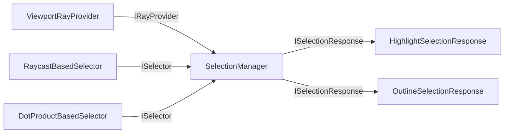

# SOLID Selection

A Unity 6 implementation of the object-selection assignment, adapted from
[bslease/SOLID](https://github.com/bslease/SOLID), commit
`6ba75c988bb1b8f7437ce94b1f4aeeba2e6d912a`.

The starter's four props, their placement, and the BOXOPHOBIC environment are
retained. Materials are converted to URP. The legacy first-person controller,
monolithic selection manager, and built-in-pipeline outline are replaced with
components compatible with this project's Input System and URP configuration.

## Run the lesson

1. Open the **SOLID Selection** project folder in **Unity 6000.3.24f1**.
2. Open `Assets/Selection/Scenes/Main.unity` and press Play.
3. Click the Game view to capture the mouse. Aim with the center crosshair.

| Control | Action |
| --- | --- |
| WASD / mouse | Move / look |
| Left Shift | Sprint |
| 1 / 2 | Direct raycast / forgiving dot-product selection |
| H / O | Material highlight / silhouette outline |
| R | Reset player position and view |
| Esc | Release the cursor |

The default is **dot product + outline**. All four selector/response combinations
work without changing the manager. Main is the enabled build scene and includes
the environment directly; runtime selection does not load scenes.

To compare behavior, aim beside the small cube. A raycast requires a collider
hit; dot selection can still select its center within the configured angle.
Look away to deselect, or move behind a tree to check occlusion.

## Designer workflow

- Select **Selection System** in the Hierarchy. Its manager Inspector has
  Raycast / Dot product and Highlight / Outline buttons. These also work in Play
  mode; Play-mode changes are temporary.
- Edit `Assets/Selection/Selection Settings.asset` to tune maximum distance,
  cone half-angle, selectable layers, blocking layers, and line of sight.
  Both selectors reference this asset. Asset edits during Play mode persist.
- Select the rig to see the dot selector's cone in Scene view.
- Add **Selectable** to a prop root, or use
  **Tools > SOLID Selection > Make Selected Objects Selectable**. The menu
  supports multiple objects and Undo. Put colliders on the root or its children.
  Put both the root and its colliders on layers included in Selectable Layers.
- The default aim point is the combined renderer-bounds center. Assign an
  **Aim Point** transform to control where dot selection aims. Explicitly assign
  **Target Renderers** when a hierarchy contains visuals that should not change.
- Use the `Selectable Cube` and `Selection System` prefabs in
  `Assets/Selection/Prefabs`. Assign the rig's camera, or let it use MainCamera.
- Assign a highlight material, or adjust the outline's material, color, and
  width. Interface reference fields reject incompatible components.

Both selectors ignore trigger colliders. The direct selector stops at the
nearest collider in the combined selectable/blocking masks. The dot selector
uses the blocking mask for its optional line-of-sight ray to the aim point;
include selectable layers in this mask if props should occlude one another.
Dot selection itself does not require a collider on the candidate.

The included outline uses an expanded back-face shell for **static convex
MeshRenderers**, matching the starter props. It respects depth and does not
change source materials or add physics colliders. Concave and skinned meshes
need a different `ISelectionResponse` implementation. Highlight supports
multiple renderers and material slots. Avoid overlapping Selectable roots or
multiple managers controlling the same renderer with these sample responses.

## Refactor and SOLID principles

The original manager is preserved for comparison in
`Reference/SelectionManager.original.cs.txt` (not compiled).

The lesson progression is represented by:

1. Extract highlight and outline responses behind `ISelectionResponse`.
2. Extract ray generation and selection behind `IRayProvider` and `ISelector`.
   `SelectionManager` becomes a coordinator with explicit Inspector references.
3. Add `DotProductBasedSelector` alongside `RaycastBasedSelector` without adding
   selection-specific branches to the manager.



| Principle | Applied here |
| --- | --- |
| Single responsibility | Ray provider creates the ray; selector chooses a target; response presents it; manager coordinates transitions. Player movement and demo UI are separate. |
| Open/closed | Add another selector or response by implementing its interface and assigning the component. The manager needs no edit. |
| Liskov substitution | Both selectors return a valid active Selectable or null. Both responses accept select/deselect transitions and clean up their visuals. Either can replace the other. |
| Interface segregation | Three small interfaces expose only ray creation, target selection, or visual response. Implementations do not need unrelated methods. |
| Dependency inversion | The manager calls interfaces. Serialized MonoBehaviour references are Unity's Inspector wiring mechanism, not concrete implementation dependencies. |

The manager runs after camera movement in LateUpdate. It sends responses only
when the target or response changes. Losing the ray, disabling a dependency,
disabling/destroying the target, or disabling the manager clears selection.
Highlight restores the original material array for every renderer instead of
assuming a single default material or creating per-frame material instances.
Selectable registration follows OnEnable/OnDisable, so spawned and removed
targets do not require a per-frame scene search.

## Dot-product selection

For each active candidate:

```text
offset = targetAimPoint - rayOrigin
score  = dot(normalize(rayDirection), normalize(offset))
accept when score >= cos(coneHalfAngle) and distance <= maximumDistance
```

Vectors are normalized so score measures alignment rather than distance.
The largest score wins. Essentially equal scores prefer the nearer candidate,
then a stable instance ID. Targets behind the camera, outside the cone, beyond
range, or exactly at the ray origin are rejected. With line of sight enabled,
occluded candidates are rejected before ranking, so they cannot hide another
valid candidate. The default 8-degree half-angle corresponds to a minimum dot
score of approximately 0.9903. This small scene scans its active candidates;
large worlds would benefit from a spatial candidate provider.

## Why ViewportPointToRay behaves better in this scene's builds

This is a first-person scene with a fixed center crosshair. The desired aim ray
comes from that crosshair, not from an independently positioned desktop mouse.
`Camera.ViewportPointToRay(new Vector3(0.5f, 0.5f, 0f))` explicitly uses the
camera viewport center at any resolution or viewport size. Unity ignores the
input vector's z coordinate and starts the ray at the near clip plane.

`ScreenPointToRay(Input.mousePosition)` uses screen-pixel cursor coordinates.
It works for free-cursor picking, and can produce the same direction when the
cursor is correctly locked at the full-screen camera center. However, cursor
focus, unlocked/escaped state, windowed builds, and camera viewport offsets can
make cursor position differ from the intended crosshair. Center-viewport aiming
removes that dependency. In this project, legacy `Input.mousePosition` also
does not match the enabled Input System backend.

See Unity's [ViewportPointToRay documentation](https://docs.unity3d.com/6000.3/Documentation/ScriptReference/Camera.ViewportPointToRay.html)
and [cursor-lock documentation](https://docs.unity3d.com/6000.3/Documentation/ScriptReference/Cursor-lockState.html).

## Validation

Verified in Unity 6000.3.24f1: **24/24 Play Mode tests passed**. Scene validation
found no missing scripts or broken prefabs. Both responses were visually
checked in the Game view. A Windows 64-bit development build completed with
**zero errors and zero warnings** at
`SOLID Selection/Builds/Windows/SOLIDSelection.exe` (build output is git-ignored).

Open **Window > General > Test Runner > PlayMode** and run
`SolidSelection.PlayModeTests`. The tests use Play mode deliberately because
registration, cleanup, and transitions depend on MonoBehaviour lifecycle calls.
They cover near misses, ranking, range, masks, occlusion, triggers, child
colliders, spawned/disabled/destroyed targets, response transitions, material
restoration, outline cleanup, and camera viewport alignment.

## Sources

- [Starting project](https://github.com/bslease/SOLID)
- [Charles Amat: SOLID Principles in Unity](https://www.youtube.com/watch?v=QDldZWvNK_E)
- [Learn By Example: SOLID Principles in Unity, Part 2](https://www.youtube.com/watch?v=Fs8jy7DHDyc)
- [Unleash the Power of Raycasts with Dot Product](https://www.youtube.com/watch?v=cxJnvEpwQHc)

This is an adaptation of the assignment's stated progression, not a verbatim
transcript of the videos. Public descriptions were accessible; caption
retrieval was unavailable. The imported BOXOPHOBIC models, textures, prefabs,
and sky shader remain in `Assets/ThirdParty/BOXOPHOBIC`, with their original
asset identities and source notices. No ownership of those assets is claimed.

